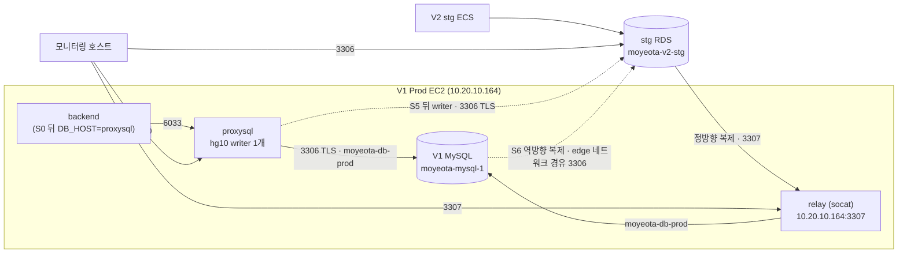

# V1 Prod → V2 Stg 데이터 마이그레이션 리허설 — binlog 복제 + ProxySQL

> 작성 2026-10-22. 이 문서가 이 리허설의 기준 런북이다. `v2-stg-proxysql-rehearsal-env-runbook.md`의 E-5 구현 게이트(runner 일반화·Terraform 분리)는 이번 변경으로 해소됐다.
> 코드: `v2/migration.tf`, `v2/templates/migration/{compose.yaml, proxysql.cnf.tpl, mig.sh, cutover-switch.sh, dashboard.json.tftpl}`
> 이 리허설 Terraform은 V1 DNS나 TLS 인증서를 생성·변경하지 않는다. API 부하 단계는 이미 승인된 V1 HTTPS endpoint가 확인된 뒤에만 진행한다.

## 0. 결정 요약

| 항목 | 결정 |
|---|---|
| 동기화 | MySQL binlog 복제 (정방향 V1 → RDS, 컷오버 뒤 역방향 RDS → V1) |
| 쓰기 지점 전환 | ProxySQL hostgroup 10의 writer를 V1 MySQL → stg RDS로 교체 |
| 소스 | 기존 V1 Prod EC2(`i-008aaad6bd675baa0`, 10.20.10.164)의 MySQL 컨테이너. 새 EC2 없음 (vCPU 한도) |
| 대상 | stg RDS `moyeota-v2-stg` (CLI 생성) |
| V1 internal 네트워크 연결 | **socat relay 사이드카** (1장) |
| V1 호스트 배치 | 기존 Compose 프로젝트(`moyeota`)와 분리된 별도 프로젝트 `moyeota-migration` — proxysql · relay · migcli 3개만 |
| VPC 연결 | 추가 없음. V2는 V1 VPC(`vpc-054f8f601f1b9f1b3`)를 공유하므로 SG 규칙만 더한다 |
| 데이터 | V1 Prod 실데이터를 stg RDS로 적재. 시작 전 stg 스냅샷, 종료 후 스냅샷에서 복원. V1 Prod DB는 복원하지 않는다 |

## 1. 네트워크 방식 선택 — V1 internal MySQL을 RDS와 연결

V1 MySQL은 `moyeota-db-prod`(internal: true) 네트워크에만 붙어 있어 호스트 포트를 게시할 수 없고, 밖으로 나가지도 못한다. RDS를 외부 복제본으로 쓰려면 **RDS가 V1에 접속**해서 binlog를 가져가야 하므로(`mysql.rds_set_external_source`), V1 MySQL 3306을 VPC 사설 주소로 노출하는 중계 지점이 필요하다.

판단 기준: ① V1 Prod를 운영 상태에서 크게 바꾸지 않을 것 ② 운영 복잡도·별도 리소스를 늘리지 않을 것

| 방식 | ① V1 변경 | ② 리소스·복잡도 | 판단 |
|---|---|---|---|
| **socat relay 사이드카** (database + edge 네트워크, 사설 IP:3307 게시) | MySQL·nginx·backend 무변경. 컨테이너 1개 추가 (0.25 vCPU / 64 MiB) | 별도 프로젝트로 띄우고 `compose down`으로 걷음. 설정 한 줄 | **선택** |
| nginx stream (기존 V1 nginx에 stream 블록) | 운영 진입점 nginx 설정 변경 + database 네트워크 연결 → nginx 재생성(서비스 전체 순단). 공개 진입점에 DB 경로가 섞임 | 추가 리소스는 없지만 장애 반경이 전체 트래픽 | 제외 |
| MySQL 포트 직접 게시 / internal 해제 | MySQL 컨테이너 재생성(=DB 재시작) 필요 | 없음 | 제외 (①에 정면으로 걸림) |
| ProxySQL을 중계로 사용 | — | — | 불가. ProxySQL은 복제 프로토콜(COM_BINLOG_DUMP)을 중계하지 않는다 |
| VPC 피어링 · TGW · PrivateLink(NLB) | — | 리소스 추가 | 불필요. 이미 같은 VPC이고, 문제는 L3가 아니라 Docker internal 네트워크 |
| SSM 포트 포워딩 · SSH 터널 | — | 세션에 묶임 | 불가. RDS가 먼저 접속해야 하는데 터널은 운영자 세션 쪽에서만 열린다 |
| DMS | — | 복제 인스턴스 추가 | 제외. binlog+ProxySQL 전략과 다르고 리소스가 늘어난다 |

역방향 복제(S6)에서 V1 MySQL이 RDS로 **나가는** 경로는 MySQL 컨테이너를 재시작하지 않고 `docker network connect moyeota-migration-edge`로 런타임에만 붙였다가 teardown에서 뗀다.

### 1.1 경로



| 출발 | 도착 | 포트 | Terraform 리소스 (`v2/migration.tf`) |
|---|---|---:|---|
| stg RDS SG | V1 Prod SG | 3307 | `migration_v1_relay_from_stg_rds` |
| V1 Prod SG | stg RDS SG | 3306 (egress) | `migration_v1_to_stg_rds` |
| V1 Prod SG | stg RDS SG | 3306 (ingress) | `migration_stg_rds_from_v1` |
| 모니터링 SG | V1 Prod SG | 3307, 6070 | `migration_v1_relay_from_monitoring`, `migration_v1_metrics_from_monitoring` |
| 모니터링 SG | stg RDS SG | 3306 | `migration_rds_from_monitoring` |

stg RDS SG(CLI 생성)는 기본 아웃바운드 전체 허용이라 RDS → V1 3307 아웃바운드는 따로 두지 않는다.

### 1.2 V1 Prod에 생기는 변경과 생기지 않는 변경

| 생긴다 (리허설 기간만) | 생기지 않는다 |
|---|---|
| 사이드카 3개 (proxysql 0.5 vCPU/256 MiB, relay 0.25/64 MiB, migcli 0.25/128 MiB) | MySQL 컨테이너 재생성·재시작, 설정·볼륨 변경 |
| S0에서 backend 1회 재생성 (DB_HOST·계정만 override, 이미지 digest 동일 확인 후) | nginx·frontend 변경, V1 `compose.yaml` 편집 |
| S6에서 MySQL 컨테이너를 edge 네트워크에 런타임 연결 | V1 Terraform state(`infra/`) 변경 |
| SG 규칙 6개(모니터링 3개 포함), EC2 Role 인라인 정책 1개 (V2 state 소유) | 새 EC2·NLB·피어링 |
| MySQL 계정 3개 (stg 앱 계정·repl·mig_mon, `sql_log_bin=0`) | V1 Prod 비밀번호를 stg로 복사 |

V1 SG 규칙은 `infra/`의 인라인 블록 소유다. 리허설이 끝날 때까지 `infra/`를 apply하지 않는다 (덧붙인 규칙이 지워진다).

## 2. 시나리오 설계

### 2.1 목적과 판정

리허설은 "Prod 컷오버 때 무엇이 유실·중복될 수 있는가"를 확인한다. 판정 지표는 아래로 고정한다.

| 지표 | 통과 기준 |
|---|---|
| 쓰기 보류 시간 (S3~S5) | 목표 ≤ 5초, 7초 초과 시 자동 R-a |
| 원장 lost (ACK됐는데 DB에 없음) | 0 |
| 원장 dup (같은 키 2건 이상) | 0 |
| unknown 응답 | 원장·DB 대조로 전부 설명 |
| 정방향/역방향 복제 | IO·SQL thread Yes, Last error 없음, 지연 0으로 수렴 |
| 행 수·스키마 대사 (S1 뒤, S10 전) | V1과 RDS 일치 (V2 DDL로 추가된 컬럼·테이블은 차이 목록으로 설명) |
| ProxySQL writer | 어느 시점에도 ONLINE writer 1개 |
| V1 EC2 | CPU credit 소진 추세 없음, MySQL 연결 포화 없음 |

### 2.2 시나리오

| ID | 시나리오 | 거치는 단계 | 확인하는 위험 |
|---|---|---|---|
| SC-1 | 초기 적재 + 정방향 복제 정합성 | S1 → S2 | 덤프 좌표 누락, 복제 시작 위치 오류, 문자셋·시간대 차이 |
| SC-2 | 무부하 컷오버 | S0 → S3~S5 | 보류 시간 하한, writer 이중화 |
| SC-3 | 부하 중 컷오버 | k6(ROUTE=v1) 중 S3~S5 | 보류 중 요청 실패·timeout, lost/dup |
| SC-4 | 전환 전 중단 (R-a) | `HOLD_LIMIT=1`로 switch → 자동 abort | V1 쓰기 즉시 복귀, 정방향 해제 뒤 재시작 절차 |
| SC-5 | 전환 후 롤백 (R-b) | S5 → S6 → k6 → rollback-b | 역방향 따라잡기, RDS에서 받은 쓰기의 V1 도착 |
| SC-6 | V2 DDL 뒤 역방향 호환 | S6 → S7 → k6(ROUTE=schedule) | 새 컬럼·테이블이 V1 복제를 멈추는지, MDL 대기 |
| SC-7 | URL 비율 전환과 R-c | S8(ROUTE=schedule) → R-c(SWITCH_DIRECTION=reverse) | V1/V2 동시 서빙 중 stale read, 원장 대조 |

SC-4·SC-5·SC-7(R-c)는 각자 깨끗한 시작 상태가 필요하다. 반복마다 S1(재적재)부터 다시 하며, stg는 스냅샷 복원 대신 S1 재적재로 초기화한다 (스냅샷 복원은 S10에서 한 번만).

권장 순서 (1회차, 부하 중 컷오버 우선): SC-1 → S0 → SC-3 → SC-5 → (S1 재적재) SC-1 → SC-4 (부하 중) → (S1 재적재) SC-1 → SC-3 → SC-6 → SC-7

1회차 첫 컷오버부터 k6 쓰기 부하를 건 상태로 전환한다. 실제 Prod 컷오버는 쓰기가 들어오는 중에 일어나므로, 보류 시간·lost/dup을 처음부터 그 조건에서 잰다. SC-2(무부하)는 따로 돌리지 않는다. 보류 시간 하한이 필요하면 SC-3의 `switch.log`에서 부하 전 구간 값을 읽는다. 따라서 T0 시드·fixture와 V1 HTTPS endpoint 검증(6장)이 1회차 시작 전 필수 게이트다.

### 2.3 단계 정의 (S0~S10)

| 단계 | 내용 | 실행 | Go 조건 |
|---|---|---|---|
| S1 | stg RDS DB 재생성 → V1 덤프(`--single-transaction --source-data=2`) 적재, 좌표 기록 | `cutover-switch s1-load` | 스냅샷 available, 행 수 일치 |
| S2 | RDS가 relay(3307)로 V1 binlog 복제 시작 | `cutover-switch s2-forward` | IO/SQL Yes, 지연 0 |
| S0 | V1 backend를 proxysql:6033 + stg 앱 계정으로 재생성 | `mig endpoint proxysql` | healthy, 5xx 없음 |
| S3 | ProxySQL V1 → OFFLINE_SOFT (신규 쓰기 보류) | `cutover-switch switch` | — |
| S4 | 진행 연결 소진 → V1 super_read_only ON → 좌표 일치 | 〃 | V1 binlog 좌표 = RDS 적용 좌표 |
| S5 | 정방향 해제, RDS ONLINE / V1 OFFLINE_HARD | 〃 | 보류 ≤ 7초 |
| S6 | RDS → V1 역방향 복제 (`REPLICATE_DO_DB`) | `cutover-switch s6-reverse` | IO/SQL Yes |
| S7 | 승인된 V2 DDL을 RDS에 적용 → stg ECS 기동 | `mig sql rds` | MDL 대기·복제 오류 없음 |
| S8 | k6 URL 비율 V1 → stg 전환 (DNS 변경 아님) | k6 `ROUTE=schedule` | 원장 lost/dup 0 |
| S9 | R-b / R-c | `cutover-switch rollback-b`, k6 reverse | 역방향 지연 0 수렴 |
| S10 | 정리 · stg 스냅샷 복원 | `mig teardown`, `terraform apply`, RDS restore | stg 원래 데이터 확인 |

S0은 S2 뒤에 둔다. S1·S2 실패로 중단해도 V1 backend는 한 번도 재생성되지 않는다.

## 3. 테스트 단계 (Go/No-Go 게이트)

| 단계 | 하는 일 | 게이트 (하나라도 실패하면 다음 단계로 가지 않음) |
|---|---|---|
| T0 사전 확인·시드 | V1 binlog·자원 확인, 테스트 전용 사용자/시드 데이터 준비, Stg 스냅샷·RDS binlog 확인 | V1 `log_bin=1`, `binlog_format=ROW`, GTID OFF / 전용 테스트 데이터만 생성 / fixture 대상 조회 성공 / 스냅샷 available / RDS 백업 보존 ≥ 1일 |
| T1 인프라 연결 | Terraform apply, SSM 값, V1 부트스트랩, 계정 | `mig check` 전 항목 PASS, `repl-smoke forward·reverse` 통과 |
| T2 적재·복제 (SC-1) | T0에서 만든 테스트 데이터까지 S1로 적재, S2, 행 수·fixture 대상 대사 | 행 수 diff 없음, 지연 0, 테스트 사용자·대상 ID가 RDS에서도 조회됨 |
| T3 ProxySQL 삽입 | S0 | 재생성~healthy 시간 기록, 5xx 없음 |
| T4 컷오버 (SC-3 우선 · SC-4) | k6 부하 중 S3~S5, R-a | 보류 ≤ 5초 (≤ 7초 허용), writer 1개, 보류 구간 5xx·timeout 없음 |
| T5 역방향·DDL (SC-5·6) | S6, S7, R-b | 역방향 Yes·지연 0, DDL 뒤에도 복제 유지 |
| T6 부하·전환 (SC-7) | S8, R-c, 원장 대조 | lost 0, dup 0, unknown 설명 |
| T7 정리 | teardown, false apply, stg 복원 | V1 backend DB_HOST=mysql(또는 S10 결정), 사이드카·규칙 없음, stg 원래 데이터 |

T0에서 전용 사용자를 포함한 시드 데이터를 V1 API로 생성하고 fixture를 만든다. S1 전체 덤프가 그 데이터를 Stg로 복사하므로, 이후 부하는 V1·Stg 양쪽에 같은 대상이 있는지 확인한 뒤 시작한다. 부하는 이미 승인된 V1 HTTPS endpoint·테스트 전용 계정·fixture가 준비된 뒤에만 건다. 첫 실행은 READ 2 / WRITE 1 / 채팅 1방 1 msg/s, 2분.

## 4. 실행 명령어

실행 위치: **[PC]** 운영자 PC (`v2/` · `loadtest-scenarios/`), **[V1]** V1 Prod SSM 세션.

### 4.0 [PC] 공통 값

```bash
export AWS_REGION=ap-northeast-2
V1_ID=i-008aaad6bd675baa0
STG_RDS=moyeota-v2-stg
STG_CLUSTER=moyeota-v2-stg
# P3에서 기존 V1 HTTPS endpoint와 인증서를 검증한 뒤 사용한다. 이 리허설은 DNS/TLS를 구성하지 않는다.
V1_API_HOST=v1.moyeota.com
V1_API_URL="https://${V1_API_HOST}"
V2_API_URL=https://stg.moyeota.com
```

이 값을 유지할 **[PC] 셸 하나를 열어 둔다**. 이후 k6 명령은 이 셸에서 실행하고, V1 SSM 세션은 별도 터미널에서 연다.

### 4.1 T0 — stg 스냅샷 · RDS binlog

```bash
aws rds describe-db-instances --db-instance-identifier "$STG_RDS" \
  --query 'DBInstances[0].[DBInstanceStatus,Endpoint.Address,EngineVersion,DBInstanceClass,BackupRetentionPeriod,DBSubnetGroup.DBSubnetGroupName,VpcSecurityGroups[*].VpcSecurityGroupId,DBParameterGroups[*].DBParameterGroupName]' \
  --output json | tee "stg-rds-manifest-$(date +%m%d%H%M).json"
SNAPSHOT_ID="moyeota-v2-stg-pre-migration-$(date +%Y%m%d%H%M)"
aws rds create-db-snapshot --db-instance-identifier "$STG_RDS" --db-snapshot-identifier "$SNAPSHOT_ID"
aws rds wait db-snapshot-available --db-snapshot-identifier "$SNAPSHOT_ID"
echo "$SNAPSHOT_ID"
```

```bash
aws rds modify-db-instance --db-instance-identifier "$STG_RDS" --backup-retention-period 1 --apply-immediately
aws rds wait db-instance-available --db-instance-identifier "$STG_RDS"
aws rds describe-db-instances --db-instance-identifier "$STG_RDS" \
  --query 'DBInstances[0].[DBInstanceStatus,BackupRetentionPeriod]' --output text
```

백업 보존이 이미 1 이상이면 두 번째 블록은 건너뛴다.

### 4.2 T1 — Terraform

`v2/terraform.tfvars`에 아래가 들어 있다 (반영 완료).

```hcl
migration_rehearsal_enabled   = true
migration_stg_rds_identifier  = "moyeota-v2-stg"
migration_v1_prod_instance_id = "i-008aaad6bd675baa0"
```

```bash
cd v2
terraform init
terraform plan -out=mig-v1prod.tfplan
terraform show -no-color mig-v1prod.tfplan | grep -E '^  # .* will be (created|destroyed|updated|replaced)'
```

plan 판정:

| 나와야 하는 것 | 나오면 멈출 것 |
|---|---|
| `aws_s3_bucket.migration` 외 버킷 설정 4개, `aws_s3_object.migration_config` 5개 | `aws_instance.*`, `aws_lb_*`, `aws_acm_*`, 또는 모든 `aws_route53_record.*` 생성 (이 migration 구성은 DNS/TLS를 관리하지 않음) |
| `aws_ssm_parameter.migration` 2개, `migration_mon_password` 1개 | `infra/` 소유 리소스 변경 |
| `aws_iam_role_policy.migration_v1_prod` | migration 리허설 범위 밖 리소스 변경 — 원인을 분리하고 다시 plan |
| SG 규칙 6개 (모니터링 포함) | |
| `module.monitoring` 설정 갱신 (데이터소스·대시보드·스크레이프 대상) | |

remote state에 예전 v1-sim 리소스(`aws_instance.migration_v1_sim` 등)가 남아 있다면 destroy가 나올 수 있다. 각 destroy 대상이 더 이상 쓰이지 않는지 확인한 뒤에만 apply한다.

```bash
terraform apply mig-v1prod.tfplan
terraform output -json migration
MIG_BUCKET="$(terraform output -json migration | jq -r .bucket)"
echo "$MIG_BUCKET"
cd ..
```

### 4.3 T1 — SSM 비밀값

```bash
aws ssm put-parameter --name /moyeota/v2/migration/REPL_PASSWORD --type SecureString --overwrite --value "$(openssl rand -hex 24)"
aws ssm put-parameter --name /moyeota/v2/migration/PROXYSQL_ADMIN_PASSWORD --type SecureString --overwrite --value "$(openssl rand -hex 24)"
aws ssm put-parameter --name /moyeota/v2/monitoring/MIGRATION_DB_MON_PASSWORD --type SecureString --overwrite --value "$(openssl rand -hex 24)"
aws ssm get-parameters --names /moyeota/v2/stg/backend/DB_NAME /moyeota/v2/stg/backend/DB_USERNAME \
  --query 'Parameters[].[Name,Value]' --output table
```

stg `DB_NAME`은 V1 backend의 `DB_NAME`(moyeota)과 같아야 한다. 다르면 `mig render`가 멈춘다.

### 4.4 T0·T1 — [V1] 부트스트랩 · 점검

```bash
aws ssm start-session --target "$V1_ID"
```

V1 세션 (MIG_BUCKET 값은 4.2 출력):

```bash
sudo docker exec moyeota-mysql-1 sh -c 'MYSQL_PWD="$MYSQL_ROOT_PASSWORD" mysql -uroot -e "SELECT VERSION(), @@server_id, @@log_bin, @@binlog_format, @@gtid_mode, @@binlog_expire_logs_seconds; SHOW BINARY LOG STATUS;"'
sudo docker stats --no-stream
free -m
df -h / /var/tmp
```

```bash
MIG_BUCKET=moyeota-v2-migration-<account-id>
sudo install -d -m 0700 /etc/moyeota-migration
printf 'MIG_BUCKET=%s\nAWS_REGION=ap-northeast-2\n' "$MIG_BUCKET" | sudo tee /etc/moyeota-migration/bootstrap.env
sudo aws s3 cp "s3://$MIG_BUCKET/config/bin/mig" /usr/local/bin/mig --region ap-northeast-2
sudo chmod 0755 /usr/local/bin/mig
sudo mig render
sudo mig users
sudo mig check
sudo mig repl-smoke forward
sudo mig repl-smoke reverse
sudo mig status
```

`mig check`에서 FAIL이 하나라도 있으면 T2로 가지 않는다. Grafana "V2 이관 리허설" 대시보드에서 V1·RDS 패널에 값이 나오는지도 본다.

### 4.4.1 T0 — [PC] 테스트 전용 시드 데이터 · fixture

T2의 S1 초기 적재 전에 한 번 실행한다. V1 DB에 이미 준비된 테스트 전용 사용자와 그 사용자에게 유효한 토큰 파일을 사용한다. 일반 사용자 데이터나 운영 JWT secret으로 토큰을 만들지 않는다. 토큰이 V1과 S1 이후 Stg 양쪽에서 유효하지 않으면 API 부하 단계는 보류한다.

```bash
cd loadtest-scenarios
V1_API_HOST=<승인된_V1_HTTPS_API_host>
k6 run \
  -e BASE_URL="https://${V1_API_HOST}" \
  -e CONFIRM_TARGET_HOST="$V1_API_HOST" \
  -e USERS_FILE=real/data/users.json \
  -e FIXTURE_OUT=out/seed-fixture.json \
  real/seed.js

python3 migration/tools/build-fixture.py \
  --seed-fixture out/seed-fixture.json \
  --users real/data/users.json \
  --base-url "https://${V1_API_HOST}" \
  --fixture-out out/prod-test-fixture.json \
  --users-out out/prod-test-users.json
```

`real/seed.js`는 공개 API로 계좌·채팅방·참여자·조회 대상 동행/커뮤니티 글을 생성한다. 이 테스트 데이터와 전용 사용자는 V1에 남고, S1 덤프에 포함되어 Stg에도 복사된다. `out/prod-test-fixture.json`의 채팅방·사용자·동행·게시글 ID가 생성됐는지 확인하고, 파일은 안전한 로컬 경로에 보관한다. k6 부하 명령에는 이 fixture와 users 파일을 그대로 지정한다. SC-4·SC-5·SC-7 반복을 위해 V1에서 시드를 다시 만들 필요는 없으며, 매회 S1 재적재로 초기 Stg 상태를 만든다.

### 4.5 T2 — S1 적재 · S2 정방향 복제 (SC-1)

```bash
sudo cutover-switch s1-load
sudo cutover-switch s2-forward
sudo cutover-switch lag
```

행 수 대사 (복제 지연 0, 부하 없는 상태에서):

```bash
DB=moyeota
Q="$(sudo mig sql v1 -N -e "SET SESSION group_concat_max_len = 1000000; SELECT GROUP_CONCAT(CONCAT('SELECT ''', table_name, ''', COUNT(*) FROM ', CHAR(96), table_schema, CHAR(96), '.', CHAR(96), table_name, CHAR(96)) ORDER BY table_name SEPARATOR ' UNION ALL ') FROM information_schema.tables WHERE table_schema = '$DB' AND table_type = 'BASE TABLE'")"
sudo mig sql v1 -N -e "$Q" > /tmp/v1-counts.tsv
sudo mig sql rds -N -e "$Q" > /tmp/rds-counts.tsv
diff /tmp/v1-counts.tsv /tmp/rds-counts.tsv && echo COUNTS_MATCH
```

fixture에 기록된 테스트 사용자와 콘텐츠가 양쪽 API에서 읽히는지 부하 없이 확인한다. 이후 k6 명령의 `FIXTURE_FILE=out/prod-test-fixture.json`, `USERS_FILE=out/prod-test-users.json` 입력이 준비되어야 T3~T6의 API 부하를 진행한다.

### 4.6 T3 — S0 ProxySQL 삽입

```bash
sudo mig endpoint proxysql
sudo mig check
curl -fsS -o /dev/null -w '%{http_code}\n' http://127.0.0.1/nginx-health
sudo docker logs --since 5m moyeota-backend-1 2>&1 | grep -Ei 'error|exception' | tail -20
```

되돌릴 때 (S5 전에만):

```bash
sudo mig endpoint mysql
```

### 4.7 T4 — 컷오버 S3~S5 (SC-3 우선 · SC-4)

1회차는 아래 SC-3(부하 중)부터 실행한다. SC-2 무부하 명령은 부하 없이 전환만 재확인할 때 쓴다:

```bash
sudo cutover-switch switch
sudo cutover-switch hg
sudo cutover-switch lag
cat /opt/moyeota-migration/state/switch.log
```

SC-4 강제 중단 (S1부터 새로 시작한 상태에서):

```bash
sudo HOLD_LIMIT=1 cutover-switch switch
sudo cutover-switch hg
sudo cutover-switch lag
```

SC-3 부하 중 — [PC] k6를 먼저 띄우고 60초 뒤 [V1]에서 `sudo cutover-switch switch`:

```bash
cd loadtest-scenarios
RUN="C$(date +%m%d%H%M%S)"
k6 run --log-format raw --console-output "out/ledger-${RUN}.log" \
  -e V1_URL="$V1_API_URL" -e V2_URL="$V2_API_URL" \
  -e CONFIRM_TARGET_HOSTS="$V1_API_HOST,stg.moyeota.com" \
  -e RUN="$RUN" -e ROUTE=v1 \
  -e READ_RPS=2 -e WRITE_RPS=1 -e CHAT_ROOMS=1 -e CHAT_MSG_RATE=1 -e DURATION=5m \
  -e FIXTURE_FILE=out/prod-test-fixture.json -e USERS_FILE=out/prod-test-users.json \
  migration/cutover.js
```

ROUTE=v1이라 모든 요청이 V1 backend → ProxySQL로 가고, 컷오버 중 writer만 RDS로 바뀐다.

### 4.8 T5 — S6 역방향 · S7 V2 DDL · R-b (SC-5 · SC-6)

```bash
sudo cutover-switch s6-reverse
sudo cutover-switch lag
```

S7 — [PC]에서 DDL을 이관 버킷 `config/sql/`에 올린다 (V1 Role은 `config/*`만 읽는다):

```bash
sha256sum "$V2_DDL_FILE"
aws s3 cp "$V2_DDL_FILE" "s3://$MIG_BUCKET/config/sql/v2-ddl.sql"
```

[V1]:

```bash
sudo aws s3 cp "s3://$MIG_BUCKET/config/sql/v2-ddl.sql" /var/tmp/moyeota-migration/v2-ddl.sql --region ap-northeast-2
sudo sha256sum /var/tmp/moyeota-migration/v2-ddl.sql
sudo mig sql rds moyeota < /var/tmp/moyeota-migration/v2-ddl.sql
sudo cutover-switch lag
sudo mig sql v1 -e "SHOW REPLICA STATUS\G" | grep -E 'Running:|Last_.*Error:|Seconds_Behind'
```

[PC] stg 앱 기동:

```bash
CLUSTER="$STG_CLUSTER" v2/scripts/ecs-stg-qa.sh up
CLUSTER="$STG_CLUSTER" v2/scripts/ecs-stg-qa.sh status
```

R-b — [PC] stg 앱을 먼저 내리고 [V1]에서 롤백:

```bash
CLUSTER="$STG_CLUSTER" v2/scripts/ecs-stg-qa.sh down
CLUSTER="$STG_CLUSTER" v2/scripts/ecs-stg-qa.sh status
```

```bash
sudo cutover-switch rollback-b
sudo cutover-switch hg
sudo cutover-switch lag
```

### 4.9 T6 — S8 URL 비율 전환 · R-c · 원장 대조 (SC-7)

S1부터 새로 시작해 S5·S6·S7까지 마친 상태에서 [PC]:

```bash
cd loadtest-scenarios
RUN="S$(date +%m%d%H%M%S)"
k6 run --log-format raw --console-output "out/ledger-${RUN}.log" \
  -e V1_URL="$V1_API_URL" -e V2_URL="$V2_API_URL" \
  -e CONFIRM_TARGET_HOSTS="$V1_API_HOST,stg.moyeota.com" \
  -e RUN="$RUN" -e ROUTE=schedule -e SWITCH_AT=60 -e SWITCH_SECONDS=120 \
  -e READ_RPS=2 -e WRITE_RPS=1 -e CHAT_ROOMS=1 -e CHAT_MSG_RATE=1 -e DURATION=5m \
  -e FIXTURE_FILE=out/prod-test-fixture.json -e USERS_FILE=out/prod-test-users.json \
  migration/cutover.js
```

R-c (S8 직후, 같은 상태에서 방향만 반대로):

```bash
RUN="R$(date +%m%d%H%M%S)"
k6 run --log-format raw --console-output "out/ledger-${RUN}.log" \
  -e V1_URL="$V1_API_URL" -e V2_URL="$V2_API_URL" \
  -e CONFIRM_TARGET_HOSTS="$V1_API_HOST,stg.moyeota.com" \
  -e RUN="$RUN" -e ROUTE=schedule -e SWITCH_DIRECTION=reverse -e SWITCH_AT=60 -e SWITCH_SECONDS=120 \
  -e READ_RPS=2 -e WRITE_RPS=1 -e CHAT_ROOMS=1 -e CHAT_MSG_RATE=1 -e DURATION=5m \
  -e FIXTURE_FILE=out/prod-test-fixture.json -e USERS_FILE=out/prod-test-users.json \
  migration/cutover.js
```

원장 대조 — [PC] `ledger.sql`을 올리고 [V1]에서 양쪽 DB 결과를 뽑는다:

```bash
aws s3 cp out/ledger.sql "s3://$MIG_BUCKET/config/sql/ledger.sql"
```

```bash
RUN=<k6 RUN 값>
sudo aws s3 cp "s3://$MIG_BUCKET/config/sql/ledger.sql" /var/tmp/moyeota-migration/ledger.sql --region ap-northeast-2
{ echo "SET @run='$RUN';"; sudo cat /var/tmp/moyeota-migration/ledger.sql; } | sudo mig sql rds -N moyeota > /tmp/rds-ledger.tsv
{ echo "SET @run='$RUN';"; sudo cat /var/tmp/moyeota-migration/ledger.sql; } | sudo mig sql v1 -N moyeota > /tmp/v1-ledger.tsv
wc -l /tmp/rds-ledger.tsv /tmp/v1-ledger.tsv
cat /tmp/rds-ledger.tsv
```

출력을 [PC] `out/`에 `rds-ledger-$RUN.tsv`, `v1-ledger-$RUN.tsv`로 저장한 뒤:

```bash
python3 migration/tools/ledger-diff.py --k6 "out/ledger-${RUN}.log" --db "out/rds-ledger-${RUN}.tsv" --replica "out/v1-ledger-${RUN}.tsv" --show 20
```

### 4.10 T7 — S10 정리

[V1] 복제 정지:

```bash
sudo cutover-switch lag
sudo mig sql v1 -e "STOP REPLICA; RESET REPLICA ALL;"
```

정방향 복제가 남아 있을 때만 (S5 전에 멈춘 경우):

```bash
sudo mig sql rds -e "CALL mysql.rds_stop_replication; CALL mysql.rds_reset_external_source;"
```

컷오버 뒤에는 V1 MySQL이 `super_read_only=ON`으로 남는다. `mig teardown`은 이 값을 바꾸지 않고, `--drop-users`(DROP USER)는 read_only 상태에서 실패한다. S10에서 V1을 쓰기 가능 상태로 되돌리기로 했다면:

```bash
sudo docker exec moyeota-mysql-1 sh -c 'MYSQL_PWD="$MYSQL_ROOT_PASSWORD" mysql -uroot -e "SET GLOBAL super_read_only = OFF; SET GLOBAL read_only = OFF; SELECT @@read_only, @@super_read_only;"'
sudo mig endpoint mysql
sudo mig teardown --drop-users
sudo rm -f /usr/local/bin/mig /usr/local/bin/cutover-switch
sudo rm -rf /etc/moyeota-migration /opt/moyeota-migration
```

V1을 read_only로 남기기로 했다면 마지막 네 줄 대신:

```bash
sudo mig endpoint mysql
sudo mig teardown
sudo rm -f /usr/local/bin/mig /usr/local/bin/cutover-switch
sudo rm -rf /etc/moyeota-migration /opt/moyeota-migration
```

이 경우 이관 계정(stg 앱 계정·repl·mig_mon)이 V1에 남으니 나중에 쓰기를 열 때 지운다.

[PC] Terraform 정리 → stg 복원:

```bash
cd v2
sed -i '' 's/^migration_rehearsal_enabled *= *true/migration_rehearsal_enabled   = false/' terraform.tfvars
terraform plan -out=mig-off.tfplan
terraform apply mig-off.tfplan
```

```bash
cd ..
STG_DB_INSTANCE_CLASS=<manifest DBInstanceClass>
STG_DB_SUBNET_GROUP=<manifest DBSubnetGroupName>
STG_DB_PARAMETER_GROUP=<manifest DBParameterGroupName>
STG_DB_SG_IDS=(<manifest VpcSecurityGroupId ...>)
RESTORE_ID="moyeota-v2-stg-restore-$(date +%m%d%H%M)"
aws rds restore-db-instance-from-db-snapshot \
  --db-instance-identifier "$RESTORE_ID" --db-snapshot-identifier "$SNAPSHOT_ID" \
  --db-instance-class "$STG_DB_INSTANCE_CLASS" --db-subnet-group-name "$STG_DB_SUBNET_GROUP" \
  --vpc-security-group-ids "${STG_DB_SG_IDS[@]}" --db-parameter-group-name "$STG_DB_PARAMETER_GROUP" \
  --no-publicly-accessible
aws rds wait db-instance-available --db-instance-identifier "$RESTORE_ID"
RESTORED_ENDPOINT="$(aws rds describe-db-instances --db-instance-identifier "$RESTORE_ID" --query 'DBInstances[0].Endpoint.Address' --output text)"
aws ssm put-parameter --name /moyeota/v2/stg/backend/DB_HOST --type SecureString --overwrite --value "$RESTORED_ENDPOINT"
CLUSTER="$STG_CLUSTER" v2/scripts/ecs-stg-qa.sh up
```

stg 스모크가 통과한 뒤에만 리허설에 쓴 RDS를 지운다:

```bash
aws rds delete-db-instance --db-instance-identifier "$STG_RDS" --skip-final-snapshot
```

`DB_HOST` 파라미터 이름·타입은 실행 전에 `aws ssm get-parameter --name /moyeota/v2/stg/backend/DB_HOST`로 확인한다. 복원 인스턴스 식별자가 `moyeota-v2-stg`가 아니게 되므로, 다음 리허설 전 `migration_stg_rds_identifier`를 맞춘다.

## 5. 중단 조건

| 영역 | 즉시 중단 |
|---|---|
| ProxySQL | ONLINE writer가 0개 또는 2개 |
| 복제 | Last_IO_Error / Last_SQL_Error 발생, 지연이 줄지 않음 |
| V1 EC2 | CPU credit이 계속 줄어듦, MySQL 연결이 max_connections에 근접, 디스크 부족 |
| 요청 | 5xx·timeout 급증 (k6 중지 → `cutover-switch abort` 또는 `rollback-b`) |
| TLS | `$V1_API_HOST` 인증서 검증 실패 → 부하 시작 금지 |

## 6. 전제·남은 게이트

- V1 API HTTPS: `$V1_API_HOST`는 이미 V1 API로 연결되고 인증서가 유효해야 한다. 이 Terraform은 DNS·인증서를 구성하지 않는다. 그런 endpoint가 없으면 API 부하가 필요한 SC-3·5·6·7은 보류하고 DB 중심의 SC-1·2·4만 진행할 수 있다.
- k6 fixture·토큰: V1 Prod와 stg 양쪽에서 유효한 테스트 전용 계정이어야 한다 (`cutover.js`는 한 토큰 세트를 양쪽에 쓴다).
- V1 Prod 데이터가 stg RDS에 들어간다. stg 접근 권한이 허용 범위인지 시작 전에 확인한다.
- V1 compose 실제 이름이 기본값과 다르면 `migration_v1_compose`로 맞춘다. `mig render`·`mig check`가 컨테이너·네트워크·DB_NAME을 대조한다.
